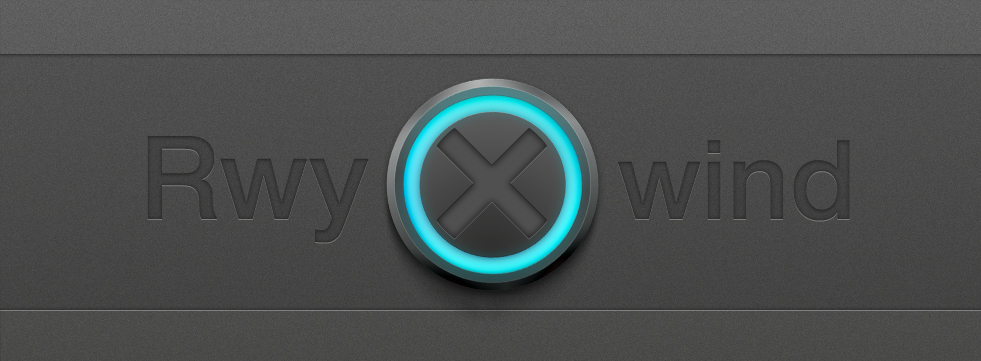
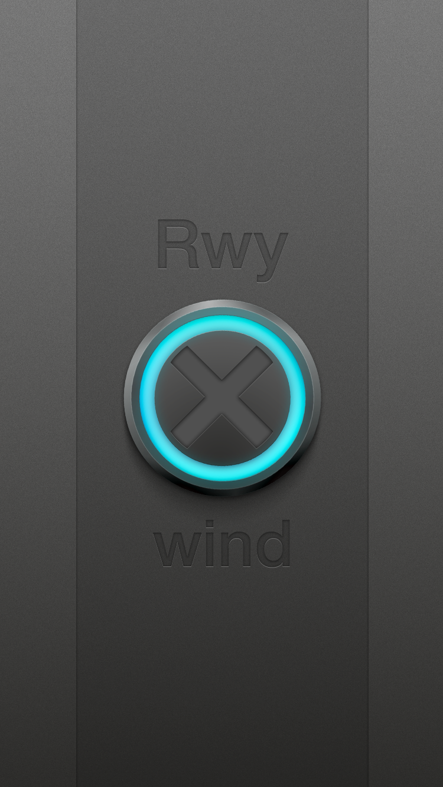
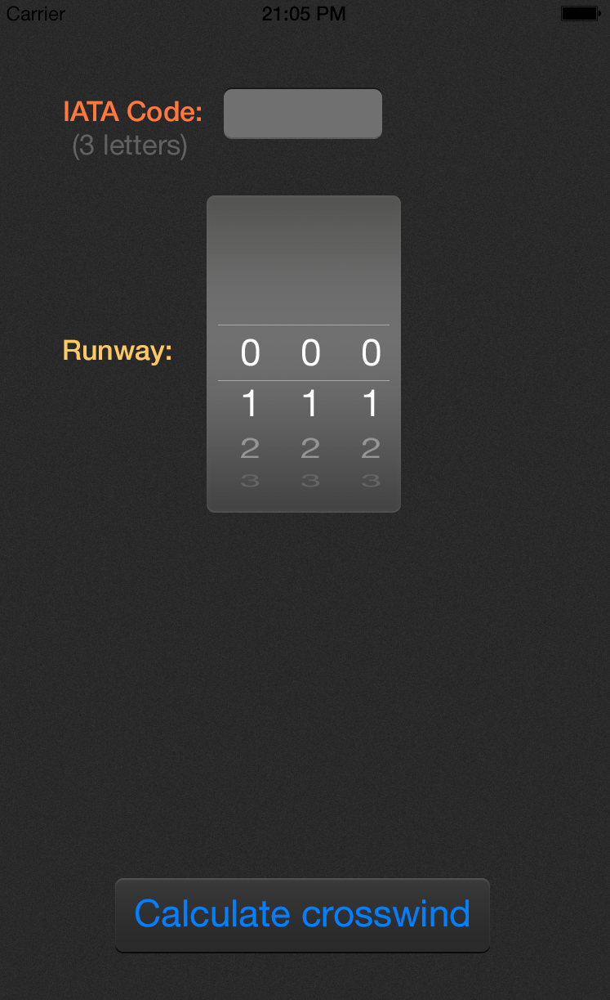
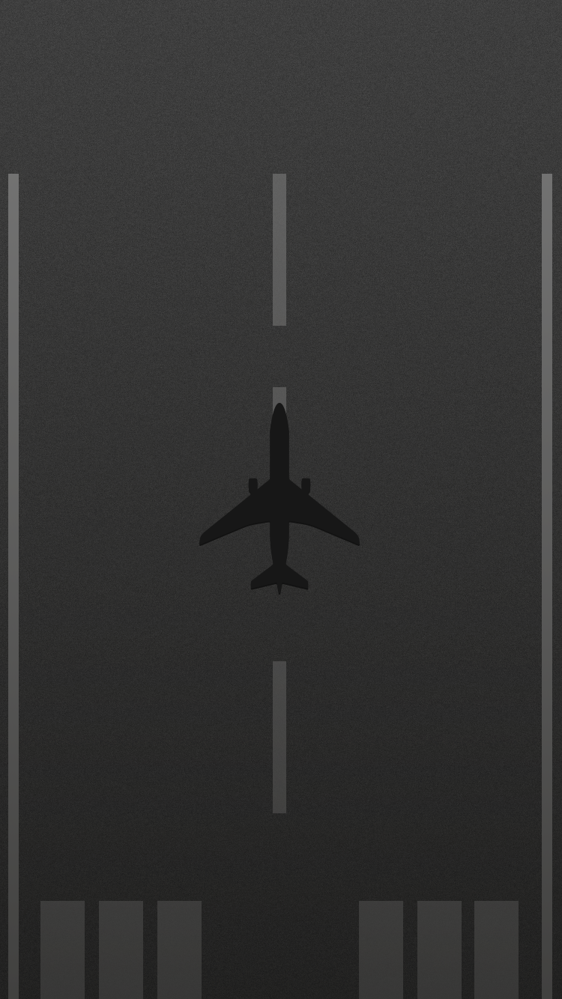

#  RwyXwind

An iOS app for pilots that calculates the wind components on the chosen runway, including the crosswind. Enter the airport's three-letter IATA code and the runway number, then tap **Calculate crosswind**.

Published on the App Store as **RwyXwind** in October 2015, retired from the store in 2021 and open-sourced here. Together with my other two published apps (HealthTexter and Solution Mix), it reached over 10,000 downloads in total.

  
  
  

## Built with

- Swift and Xcode

## Status

No longer maintained. The code is kept here as a record of the app.

## Author

ion-

